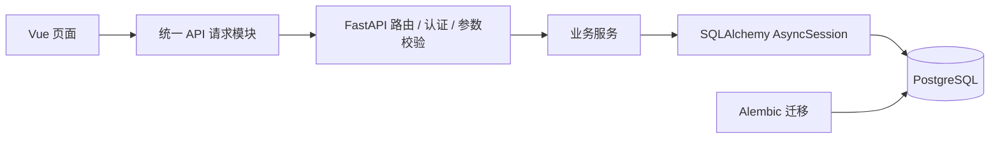

# Tallywise · 个人记账系统

[](https://github.com/8ight1een/-Tallywise/actions/workflows/ci.yml)

源于家人的日常记账需求，支持记录收入与支出、按月查看流水和统计收支。项目采用 Vue 3 + FastAPI + PostgreSQL，围绕用户数据隔离、金额与日期处理、数据库迁移和自动化检查持续迭代。

[项目功能](#项目功能) · [架构与设计](#架构与设计) · [快速启动](#快速启动) · [测试与协作](#测试与协作)

## 项目功能

| 模块 | 当前能力 |
| --- | --- |
| 用户与登录 | 邮箱注册、登录、恢复登录状态、退出登录；密码哈希存储，JWT 通过 HttpOnly Cookie 传递 |
| 收支记录 | 页面支持新增、编辑、删除流水，切换月份和筛选收入/支出；后端提供流水查询、修改与删除接口 |
| 流水分页 | 按月游标分页（`GET /api/transactions/page`），同一天多条记录不重复、不遗漏；返回 `next_cursor` 与 `has_more`，非法游标返回 422 |
| 账户与分类 | 记账时选择或创建账户、收支分类；后端提供账户与分类的增删改查接口 |
| 月度汇总 | 展示指定月份的收入、支出和收支结余，无记录时返回零 |
| 用户数据隔离 | 后端根据登录用户限定查询与操作范围，校验流水关联的账户、分类归属 |

一次完整使用流程：**注册并登录 → 创建账户和分类 → 记录收支 → 切换月份查看流水与汇总**。

## 技术栈

| 层次 | 技术 |
| --- | --- |
| 前端 | Vue 3、TypeScript、Vite |
| 后端 | FastAPI、Pydantic、SQLAlchemy AsyncSession、asyncpg |
| 数据存储 | PostgreSQL、Alembic |
| 认证与配置 | PyJWT、pwdlib / Argon2、Pydantic Settings |
| 测试与代码检查 | pytest、pytest-asyncio、Ruff、mypy、ESLint、Oxlint、vue-tsc |
| 运行与协作 | Docker Compose、GitHub Actions、PR 与分支保护 |

## 架构与设计



路由层处理 HTTP 参数和响应，服务层处理用户、记账与报表业务；会话依赖统一管理事务。业务异常由应用入口映射为 HTTP 响应，避免各路由重复处理同类错误。

### 关键设计

- **事务边界集中管理**：请求使用 `session.begin()` 管理提交与回滚，服务执行 `flush()` 写入数据库，便于在同一个事务内组合业务操作。[会话管理](backend/database.py) · [记账服务](backend/services/ledger.py)
- **金额与业务约束分层校验**：金额使用 Python `Decimal` 和 PostgreSQL `NUMERIC(9, 2)`，以正数存储，由收支类型区分方向；Pydantic 校验输入，数据库通过 CHECK、唯一约束和外键约束兜底。金额响应按十进制字符串序列化。[数据模型](backend/model.py) · [接口模型](backend/schemas.py)
- **按查询方式设计索引**：月度查询使用“用户 ID + 日期范围”，普通月份采用 `[本月第一天, 下月第一天)`；分页按 `(transaction_date DESC, id DESC)` 排序，索引扩展为 `(user_id, transaction_date, id)`，等值、范围和排序一次满足，避免在日期列上提取年月后过滤。实际执行计划仍取决于数据量和统计信息。[报表查询](backend/services/reports.py)
- **游标分页而不是 OFFSET**：用上一页最后一条的排序键做 keyset 条件，`(transaction_date, id) < (...)` 保证同一天多条不重复、不遗漏；游标编码成 URL 安全字符串交给客户端原样回传，多取一条判断 `has_more`，非法或空游标返回 422。代价是不支持跳页和总页数。[分页服务](backend/services/pagination.py)
- **区分业务日期和创建时间**：`transaction_date` 使用 `DATE`；`created_at` 使用数据库生成的带时区时间。不传年月时，通过数据库 `CURRENT_DATE` 确定当前月份，避免后端机器时区影响默认月份。
- **结构变更可追踪**：使用 Alembic 管理建表、Identity 主键对齐和时间字段迁移；CI 检查迁移后结构与 ORM 的一致性。历史 MySQL 脚本仅作为早期实现保留，当前使用 PostgreSQL。[迁移目录](backend/migrations/versions)
- **请求可追踪**：JSON 日志包含请求编号，响应携带 `X-Request-ID`；未处理异常记录堆栈并返回通用错误信息。`/api/health` 执行数据库查询，数据库不可用时返回 503。[日志配置](backend/logging_config.py) · [请求中间件](backend/middleware.py)

### 代码结构

```text
backend/
├── main.py             # 应用入口、异常处理
├── routers/            # 用户与记账 HTTP 接口
├── services/           # 用户、记账、报表、分页业务
├── model.py            # ORM 模型、约束与索引
├── schemas.py          # 请求校验与响应模型
├── database.py         # 异步连接与事务管理
├── config.py           # 环境配置与校验
├── migrations/         # 数据库版本迁移
└── tests/              # 参数、服务、接口、配置与迁移测试
frontend/src/
├── api/                # 请求封装与登录失效处理
├── components/         # 登录、记账、流水列表与汇总组件
└── types/              # 接口数据类型
database/               # SQL 建表脚本
.github/workflows/      # CI 配置
compose.yaml            # PostgreSQL 与后端容器配置
```

## 快速启动

以下命令使用 PowerShell。前端需要 Node.js 24.12+；容器方式需要已启动的 Docker Desktop 或 Docker Engine，以及 Docker Compose。

### 1. 获取项目并配置环境

```powershell
git clone https://github.com/8ight1een/-Tallywise.git
Set-Location -LiteralPath '.\-Tallywise'
Copy-Item .env.example .env
```

编辑根目录 `.env`，将 `POSTGRES_PASSWORD` 和 `SECRET_KEY` 替换为自己的数据库密码与随机签名密钥。已有 `.env` 时保留现有配置，不要重复覆盖。

### 2. 启动数据库与后端

```powershell
docker compose up --build -d
docker compose logs -f backend
```

Compose 会启动 PostgreSQL，等待数据库健康检查通过，再执行 `alembic upgrade head` 并启动后端。数据库数据保存在 `pgdata` 卷中。当前 Compose 覆盖数据库和后端，前端按下一步在本地启动。

- 接口文档：[http://127.0.0.1:8000/docs](http://127.0.0.1:8000/docs)
- 健康检查：[http://127.0.0.1:8000/api/health](http://127.0.0.1:8000/api/health)

### 3. 启动前端

在项目根目录打开另一个终端：

```powershell
cd frontend
npm ci
npm run dev
```

打开终端显示的地址，默认是 `http://localhost:5173`。Vite 将 `/api` 请求代理到 `127.0.0.1:8000`。首次使用自行注册账号，再在记账表单中创建账户和分类。

<details>
<summary>不用 Docker：在本地运行后端</summary>

需要 Python 3.14、PostgreSQL 18，以及可用的 `psql` 命令。以下步骤用于首次初始化空库；已有数据库不要重复建库，也不要重复执行手写建表脚本。

在项目根目录执行：

```powershell
psql -U postgres -c "CREATE DATABASE tallywise;"
cd backend
py -3.14 -m venv .venv
.\.venv\Scripts\python.exe -m pip install -r requirements-dev.txt
Copy-Item .env.example .env
```

编辑 `backend/.env` 中的数据库连接参数和 `SECRET_KEY`。根目录 `.env` 供 Compose 使用，`backend/.env` 供本地后端使用。

```powershell
.\.venv\Scripts\python.exe -m alembic upgrade head
.\.venv\Scripts\python.exe -m uvicorn main:app --reload
```

已有手工建表数据库应先核对结构，再确定迁移起点；`alembic stamp` 只标记版本，不会修复表结构。旧时间字段迁移还需确认历史时间的来源时区。

</details>

## 测试与协作

[GitHub Actions](https://github.com/8ight1een/-Tallywise/actions/workflows/ci.yml) 在 PR 和向 `main` 推送时运行两项任务；顶部徽章展示 `main` 的 CI 状态。

| 任务 | 检查内容 |
| --- | --- |
| `backend` | Ruff 检查与格式校验、mypy、Alembic 升级与结构一致性检查、pytest；使用 PostgreSQL 18 服务 |
| `frontend` | ESLint / Oxlint 检查、TypeScript 类型检查与 Vite 构建 |

后端测试覆盖输入校验、注册登录、用户数据隔离、账户与分类约束、流水增删改、流水分页（同日不漏、游标边界、用户隔离）、月份边界、闰年、空汇总，以及配置和离线迁移。数据库测试使用真实 PostgreSQL：每次 pytest 运行在首次使用数据库夹具时，清理专用测试库中的业务表与迁移版本记录，再执行 `alembic upgrade head` 建表；每个测试前仅清空业务数据。测试直接使用迁移创建的表结构，CI 继续保留 Alembic 一致性检查。`schema_pg.sql` 作为结构参考，不再用于测试建表。

<details>
<summary>在本地运行检查</summary>

先按本地后端说明配置环境并安装开发依赖。数据库测试会重建、清空业务表，必须使用可清空的独立测试库，不能指向保存数据的数据库。

在 `backend` 目录执行，建库账号与连接参数按本机配置调整：

```powershell
psql -U postgres -c "CREATE DATABASE tallywise_test;"
$env:TEST_DATABASE_NAME = "tallywise_test"
.\.venv\Scripts\python.exe -m ruff check .
.\.venv\Scripts\python.exe -m ruff format --check .
.\.venv\Scripts\python.exe -m mypy .
.\.venv\Scripts\python.exe -m pytest -q
```

`backend/.env` 中的 `DATABASE_NAME` 保持为开发库；测试会使用 `TEST_DATABASE_NAME` 切换到测试库，并检查两者不能相同。

在 `frontend` 目录执行：

```powershell
npm run lint:ci
npm run build
```

</details>

`main` 已启用分支保护：通过开发分支提交 PR，`backend` 与 `frontend` 检查通过、分支同步最新 `main` 后再合并。个人开发不要求他人审批，保护规则同样约束管理员。

## 当前边界

- 前端已支持流水的编辑与删除；分页接口目前只在后端提供，页面仍一次加载整月流水。
- 分页按月、按 `(日期, id)` 游标继续向后翻，不支持跳页和总页数；游标不绑定月份，跨月复用会得到空页或残缺一页。
- 退出登录通过清除 Cookie 完成，已签发 JWT 没有即时撤销机制。
- 容器配置用于本地运行；线上部署还需配置 HTTPS、反向代理、Secure Cookie 和数据库备份。
