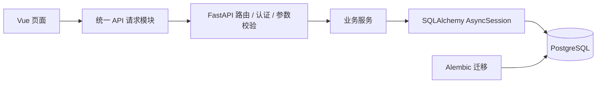

# Tallywise · 个人记账系统

[](https://github.com/8ight1een/-Tallywise/actions/workflows/ci.yml)

面向家庭日常记账的全栈项目：多用户隔离的收支记录、幂等创建流水、按月流水与汇总、不重不漏的游标分页，以及从数据库迁移、接口测试到 CI 的完整工程链路。

前端 Vue 3 + TypeScript，后端 FastAPI + SQLAlchemy 2（异步）+ PostgreSQL，接口 20 个，后端测试 143 个。

[项目亮点](#项目亮点) · [技术选型](#技术选型) · [架构](#架构) · [设计取舍](#设计取舍) · [接口](#接口) · [工程质量](#工程质量) · [快速开始](#快速开始)

## 项目亮点

- **多用户数据隔离**：所有查询以登录用户为边界；流水关联账户、分类时同时校验归属，跨用户 ID 无法读写。
- **重复提交只创建一次**：创建流水要求 `Idempotency-Key`，用 `(user_id, idem_key)` 唯一约束和 `ON CONFLICT` 抢键；同键同体返回原流水，同键异体返回 409，前端失败重试复用同一个键。
- **游标分页不重不漏**：按 `(transaction_date, id)` 做 keyset 分页，同一天多条记录不会因翻页丢失或重复；深页不随页码变慢。
- **事务边界集中**：每个请求一个逻辑事务，服务层只 `flush()`；所有写接口在返回前 `commit()`，读接口不提交，客户端看到成功时数据已经落库。
- **约束分层**：Pydantic 校验输入、数据库用 `CHECK` / 外键 / 唯一约束兜底，金额用 `NUMERIC(9,2)` 而非浮点。
- **可追踪、可回归**：请求 ID + 结构化日志；CI 覆盖 lint、类型检查、迁移一致性和 143 个后端测试（数据库相关用例跑在真实 PostgreSQL 上）。

## 技术选型

| 层次 | 技术 | 为什么 |
| --- | --- | --- |
| 前端 | Vue 3、TypeScript、Vite | 组合式 API 管理页面状态，类型约束接口边界 |
| 后端 | FastAPI、Pydantic | 声明式参数校验与 OpenAPI 文档，异常映射集中 |
| 数据访问 | SQLAlchemy 2 AsyncSession、asyncpg | 全链路异步；用表达式构造查询，避免字符串拼接 SQL |
| 数据库 | PostgreSQL 18 | 事务性 DDL、行构造器比较、执行计划可分析 |
| 迁移 | Alembic | 结构变更可追踪，CI 校验模型与库一致 |
| 认证 | PyJWT、HttpOnly Cookie、Argon2 | 前端不接触令牌，降低 XSS 读取风险 |
| 质量 | Ruff、mypy、pytest、ESLint、Oxlint、vue-tsc | 静态检查 + 集成测试，CI 与本地命令一致 |

## 架构



一次请求的路径：路由做参数校验与鉴权 → 服务层构造查询/写入 → 写请求在返回前提交，读请求不提交 → 业务异常在应用入口映射为 HTTP 状态码。服务层不直接面向 HTTP，便于单独测试。

```text
backend/
├── main.py             # 应用入口、异常映射
├── routers/            # HTTP 接口（用户、记账）
├── services/           # 用户、记账、报表、分页
├── model.py            # ORM 模型、约束与索引
├── schemas.py          # 请求校验与响应模型
├── database.py         # 异步连接池与会话生命周期
├── migrations/         # Alembic 迁移
└── tests/              # 143 个测试（含真实 PostgreSQL）
frontend/src/
├── api/                # 请求封装、401 统一处理
├── components/         # 登录、记账、流水、汇总
├── router/ · types/    # 路由与接口类型
└── assets/
```

### 事务约定

- 写路由在返回前 `commit()` 一次。
- service 只 `flush()`，不提交。
- 读路由不提交，查询结束后由会话关闭或回滚。
- 一个请求只保留一个明确的提交点。

## 设计取舍

| 决策 | 选择 | 原因 | 代价 |
| --- | --- | --- | --- |
| 分页 | keyset 游标 | 深页只扫一页的量；同日多条有唯一排序 | 不能跳页、不能显示总页数 |
| 索引 | `(user_id, transaction_date, id)` | 等值 + 范围 + 排序一次满足 | 索引多一列，写入维护成本略增 |
| 幂等 | `(user_id, idem_key)` 主键 + `ON CONFLICT` | 唯一索引原子裁决；重复请求返回原结果 | 键需要保留和清理；客户端必须配合传键 |
| 事务 | 写路由返回前提交，service 只 `flush()` | 一个请求是一个原子单元；2xx 代表数据已落库 | 每个写接口都要显式 `commit()`，漏写会丢数据 |
| 金额 | `NUMERIC(9,2)` + `Decimal` | 精确小数，无浮点误差 | 金额上限 9,999,999.99 |
| 时间 | `DATE` 业务日期 + `timestamptz` 创建时间 | 业务日期与审计时间语义分离 | 展示时区由前端决定 |
| 认证 | JWT 放 HttpOnly Cookie | 前端不接触令牌 | 无状态，签发后无法即时吊销 |
| 迁移 | Alembic + CI `alembic check` | 结构可追溯，模型与库不漂移 | 每次改模型都要配套迁移 |
| 测试 | 真实 PostgreSQL，迁移建表 | 约束、索引、事务行为都能覆盖 | 需要可清空的专用测试库 |

### 深入：游标分页

问题：`LIMIT/OFFSET` 翻到第 N 页要先扫过并丢弃前 `(N-1) × limit` 行；同时，只按日期排序时同一天多条记录的顺序不稳定，翻页会漏项或重复。

做法：按 `(transaction_date DESC, id DESC)` 排序，把上一页最后一条的排序键编码成不透明游标，下一页用行构造器比较继续：

```sql
SELECT ... FROM transactions
WHERE user_id = :user_id
  AND transaction_date >= :month_start
  AND transaction_date <  :next_month_start
  AND (transaction_date, id) < (:last_date, :last_id)
ORDER BY transaction_date DESC, id DESC
LIMIT :limit + 1;
```

几个关键点：

- **行比较代替 `AND`**：`date < d AND id < i` 会漏掉「日期更早但 id 更大」的行，字典序比较才正确。
- **多取一条判断 `has_more`**：避免额外 `COUNT(*)`；书签取本页最后一条，不是多出来的那条。
- **游标不透明**：Base64 编码 `{日期, id}`，客户端原样回传；解不开、类型不对、越界统一返回 422，不静默回第一页。
- **索引与排序同向**：索引列为 `(user_id, transaction_date, id)`，与 `ORDER BY transaction_date DESC, id DESC` 一致，可反向扫描；如果索引缺 `id`，同一天内的排序会退化成 `Incremental Sort`。
- **半开区间**：月份用 `[本月第一天, 下月第一天)`，避免月末天数与时区边界问题，也不在日期列上做函数运算。

实现见 [`backend/services/pagination.py`](backend/services/pagination.py)，测试见 [`backend/tests/test_pagination.py`](backend/tests/test_pagination.py)（覆盖同日不漏、满页无书签、空游标/乱码游标 422、跨用户隔离）。

### 深入：幂等创建流水

问题：用户双击、客户端超时重试、网关重投，都可能让同一个“创建流水”请求到达两次。前端按钮防抖只能改善体验，不能保证服务端只执行一次。

做法：创建流水必须带 `Idempotency-Key`；服务端用 `(user_id, idem_key)` 复合主键保存键，并用 `INSERT ... ON CONFLICT DO NOTHING` 抢键：

```sql
INSERT INTO idempotency_keys (user_id, idem_key, request_hash)
VALUES (:user_id, :idem_key, :request_hash)
ON CONFLICT (user_id, idem_key) DO NOTHING
RETURNING user_id;
```

返回值分两种：

- 返回一行：本次请求抢到键，继续校验账户/分类、创建流水，并在同一事务里回填 `transaction_id`；
- 返回 0 行：键已存在，查询原记录；`request_hash` 相同返回原流水，不同返回 409。

几个关键点：

- **唯一索引是仲裁者**：`SELECT` 再 `INSERT` 在并发下不可靠，查和插之间存在窗口；复合主键/唯一索引才能原子裁决。
- **键和流水同事务**：键插入、流水插入、`transaction_id` 回填一次提交；任一步失败，键也回滚，客户端可以安全重试。
- **请求指纹**：对规范化后的 JSON 做 SHA-256，字段顺序不影响结果；同键不同体返回 409，不静默执行第二次。
- **用户隔离**：主键包含 `user_id`，不同用户用同一个 UUID 不会互相阻塞，也不能拿到对方的流水。
- **提交在返回前**：创建接口在返回 `201` 或重放响应前提交，避免“响应成功但事务未提交”。
- **前端配合**：创建请求生成 `crypto.randomUUID()`，失败重试复用；成功或修改表单字段后清空；PUT 编辑不需要幂等键。

实现见 [`backend/services/ledger.py`](backend/services/ledger.py)，迁移见 [`backend/migrations/versions`](backend/migrations/versions)，测试见 [`backend/tests/test_idempotency.py`](backend/tests/test_idempotency.py) 和 [`backend/tests/test_api.py`](backend/tests/test_api.py)（覆盖顺序重复、同键异体、不同键同体、并发抢键、用户隔离和事务失败回滚）。

## 接口

所有接口以 `/api` 为前缀；除注册、登录、退出和健康检查外，其余接口都需要登录 Cookie。

| 方法 | 路径 | 说明 |
| --- | --- | --- |
| GET | `/api/health` | 健康检查，包含一次数据库查询 |
| POST | `/api/auth/register` | 注册 |
| POST | `/api/auth/login` | 登录，写入 HttpOnly Cookie |
| POST | `/api/auth/logout` | 退出，清除 Cookie |
| GET | `/api/auth/me` | 当前登录用户 |
| GET | `/api/transactions` | 当前用户全部流水（兼容旧接口） |
| POST | `/api/transactions` | 新增流水；必须带 `Idempotency-Key`（1—200 字符） |
| PUT | `/api/transactions/{id}` | 修改流水 |
| DELETE | `/api/transactions/{id}` | 删除流水 |
| GET | `/api/transactions/page` | 按月游标分页，参数 `year`、`month`、`limit`、`cursor` |
| GET | `/api/transactions/{year}/{month}` | 按月全量（旧接口） |
| GET | `/api/summary` | 月度收入、支出、结余，参数 `year`、`month` |
| GET / POST | `/api/accounts` | 账户列表 / 新增 |
| PUT / DELETE | `/api/accounts/{id}` | 修改 / 删除账户 |
| GET / POST | `/api/categories` | 分类列表（`money_type`）/ 新增 |
| PUT / DELETE | `/api/categories/{id}` | 修改 / 删除分类 |

创建流水首次返回 `201`；同键同体重放返回 `200` 并带 `Idempotent-Replayed: true`；同键不同请求体返回 `409`。

分页响应：

```json
{
  "items": [
    {
      "id": 106,
      "account_id": 1,
      "category_id": 4,
      "money": "5000.00",
      "money_type": "收入",
      "description": null,
      "transaction_date": "2026-10-18",
      "created_at": "2026-10-18T09:12:00+08:00"
    }
  ],
  "next_cursor": "eyJkIjoiMjAyNi0xMC0xOCIsImlkIjoxMDZ9",
  "has_more": true
}
```

最后一页返回 `"next_cursor": null, "has_more": false`。

## 工程质量

| 任务 | 检查内容 |
| --- | --- |
| `backend` | Ruff 检查与格式校验、mypy、`alembic upgrade head` + `alembic check`、pytest（PostgreSQL 18 服务） |
| `frontend` | Oxlint / ESLint、`vue-tsc` 类型检查、Vite 构建 |

测试策略：使用真实 PostgreSQL，每次运行先清理专用测试库并执行 `alembic upgrade head` 建表，每个用例前只清空业务数据——保证测的是迁移后的真实结构，而不是 ORM 临时建表。覆盖注册登录、用户隔离、账户/分类约束、流水增删改、幂等重放与并发抢键、写接口提交次数、读接口不提交、提交失败、分页边界、月份与闰年、空汇总、配置校验和离线迁移。

<details>
<summary>本地运行检查</summary>

```powershell
# backend
psql -U postgres -c "CREATE DATABASE tallywise_test;"
$env:TEST_DATABASE_NAME = "tallywise_test"
.\.venv\Scripts\python.exe -m ruff check .
.\.venv\Scripts\python.exe -m ruff format --check .
.\.venv\Scripts\python.exe -m mypy .
.\.venv\Scripts\python.exe -m pytest -q

# frontend
npm run lint:ci
npm run build
```

测试库必须可清空，`TEST_DATABASE_NAME` 与 `DATABASE_NAME` 不同，否则测试会拒绝运行。

</details>

## 快速开始

需要 Docker Desktop（或 Docker Engine + Compose）；前端需要 Node.js 24.12+。

```powershell
git clone https://github.com/8ight1een/-Tallywise.git
Set-Location -LiteralPath '.\-Tallywise'
Copy-Item .env.example .env
# 编辑 .env：替换 POSTGRES_PASSWORD 与 SECRET_KEY
docker compose up --build -d
```

Compose 启动 PostgreSQL，健康检查通过后执行 `alembic upgrade head` 并启动后端。

```powershell
cd frontend
npm ci
npm run dev
```

- 接口文档：<http://127.0.0.1:8000/docs>
- 健康检查：<http://127.0.0.1:8000/api/health>
- 前端：终端输出的地址，默认 <http://localhost:5173>（`/api` 已代理到后端）

<details>
<summary>不用 Docker：本地运行后端</summary>

需要 Python 3.14、PostgreSQL 18 和 `psql`。

```powershell
psql -U postgres -c "CREATE DATABASE tallywise;"
cd backend
py -3.14 -m venv .venv
.\.venv\Scripts\python.exe -m pip install -r requirements-dev.txt
Copy-Item .env.example .env      # 配置数据库连接与 SECRET_KEY
.\.venv\Scripts\python.exe -m alembic upgrade head
.\.venv\Scripts\python.exe -m uvicorn main:app --reload
```

已有手工建表的数据库先核对结构再确定迁移起点；`alembic stamp` 只记录版本，不修复表结构。

</details>

## 边界与后续

- 分页只支持按月、按 `(日期, id)` 向后翻，不支持跳页和总页数；游标不绑定月份，跨月复用会得到空页或残缺一页。
- 分页接口目前只在后端提供，页面仍一次加载整月流水；前端已支持流水的新增、编辑与删除。
- 创建流水必须带 `Idempotency-Key`，未带键的旧客户端会收到 422；幂等键当前只增不删，尚未做过期清理。
- `PUT` 编辑按 `id` 更新，不使用幂等键；只有创建流水需要幂等保护。
- 事务提交统一放在写路由返回前，读接口不提交；新增写接口时必须同步加 `commit()`，否则响应成功也不会落库。
- 认证是无状态 JWT，没有即时吊销机制；退出登录仅清除 Cookie。
- 未做缓存、限流与多实例部署；容器配置面向本地运行，线上还需要 HTTPS、反向代理、Secure Cookie 和备份策略。

## 可以深入讨论的点

| 话题 | 代码入口 |
| --- | --- |
| 游标分页、索引设计与 `EXPLAIN` | [`services/pagination.py`](backend/services/pagination.py) |
| 幂等键、请求指纹与并发抢键 | [`services/ledger.py`](backend/services/ledger.py) · [`tests/test_idempotency.py`](backend/tests/test_idempotency.py) |
| 事务边界与回滚 | [`database.py`](backend/database.py) · [`routers/items.py`](backend/routers/items.py) · [`services/ledger.py`](backend/services/ledger.py) |
| 用户数据隔离与越权防护 | [`routers/items.py`](backend/routers/items.py) |
| 迁移链与结构一致性 | [`migrations/versions`](backend/migrations/versions) |
| 异常映射与请求追踪 | [`main.py`](backend/main.py) · [`middleware.py`](backend/middleware.py) |
| 前端登录失效与请求封装 | [`frontend/src/api/client.ts`](frontend/src/api/client.ts) |
